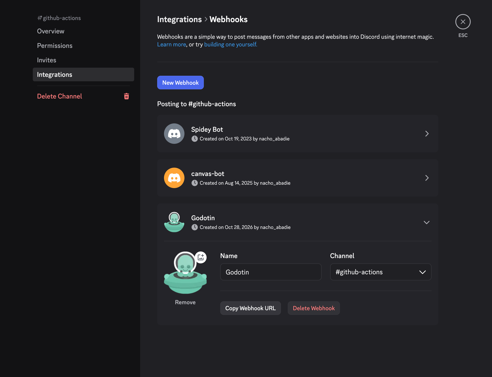
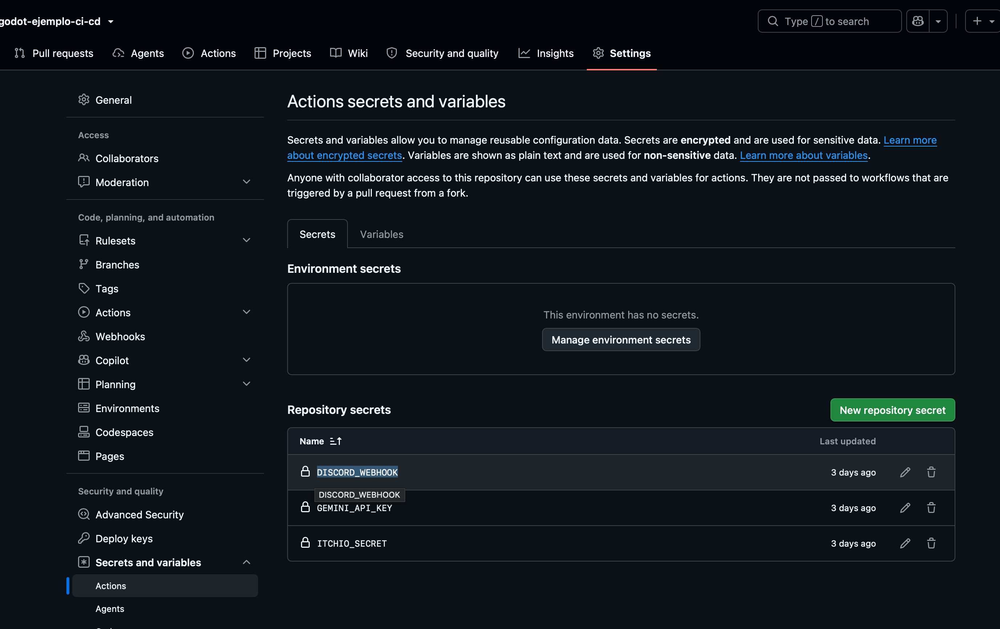
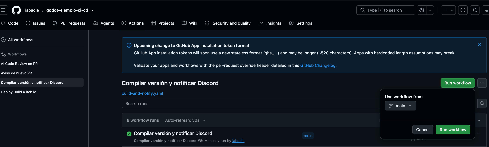
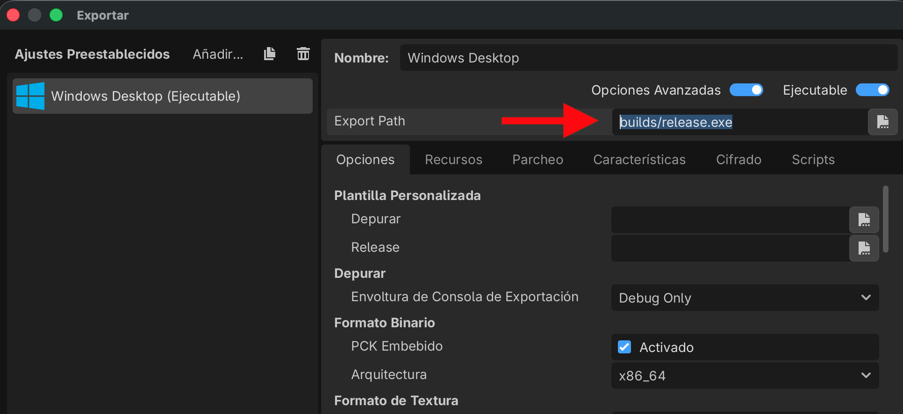
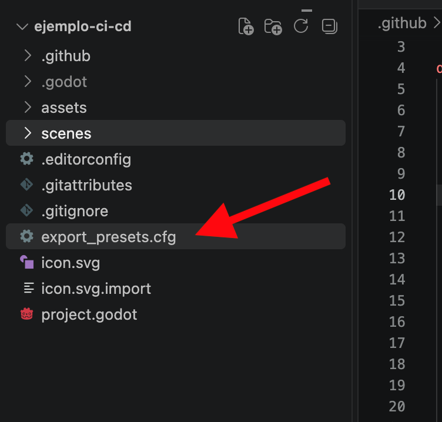
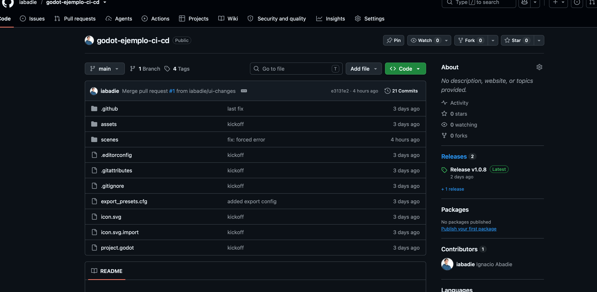

## CI / CD 

Para utilizar los workflows de github actions debemos crear archivos con formato `.yaml`. Cada uno de estos archivos será un workflow que dependiendo de la configuración se ejecutará automáticamente para ejecutar distintas tareas.

### Donde ubicar estos archivos

En este repo ejemplo pueden encontrar 3 workflows. Pueden copiarlos y llevarlos a sus proyectos.
los archivos `.yaml` se encuentran dentro de la carpeta `.github/workflows/`. El mismo formato de carpeta debe respetarse en sus proyectos para que funcionen de manera automática.


### pull-request-check

este workflow está configurado de forma tal que se disparará automáticamente solo ante el evento de `Abrir un pull request`


```
on:
  pull_request:
    branches: [ "main" ]
    types: [ opened ]
```

Cuando esto suceda, el workflow intentará enviar una notificación al canal de discord configurado mediante `DISCORD_WEBHOOK: ${{ secrets.DISCORD_WEBHOOK }}`

Por ello es imprescindible configurar la secret (variable oculta en el sistema).
Este `DISCORD_WEBHOOK` se puede obtener entrando a la configuración del canal de discord correspondiente, ingresando a integraciones y webhooks. Allí se pueden crear nuevos webhooks y configurar su nombre e imagen.



Luego de copiar el webhook url, ingresar al repositorio de `github -> settings -> secrets and variables -> actions` y agregar una nueva secret al repositorio con el nombre pertinente.



Del mismo modo se pueden agregar las demás que se necesiten.

### build-and-notify

En este caso el wrokflow está configurado para dispararse manualmente en lugar de un evento de pull request. Para ello se utiliza le key `workflow_dispatch` dentro del `on` (ver el código del workflow)

En la pestaña de actions del repositorio, seleccionar el workflow de compilar y notificar y presionar el botón de `run workflow`



De esta forma el workflow comenzará a ejecutarse automáticamente.

Para que este workflow funcione correctamente es necesario ajustar 2 parámetros acorde a su proyecto:

los parámetros de `godot_executable_download_url`| `godot_export_templates_download_url`  deben utilizar la url de descarga de la versión correcta de Godot que estén utilizando en el proyecto. Si su versión difiere, simplemente cambien los números.

además, el proyecto de Godot debe exportar utilizando el mismo path y nombre de archivo. En este caso la configuración por defecto en la sección de Export del motor es `builds/release.exe`



Es importante que el archivo `export_presets` esté correctamente trackeado en github



Si el path que utilizan en el motor es diferente, deberán modificar el script de `build-and-notify.yaml` donde dice `files: /home/runner/.local/share/godot/builds/Windows Desktop/release.exe` para ajustarlo a sus preferencia.

una vez compilado en workflow enviará una notificación Discord. (Requiere configurar el webhook, si no lo necesitan pueden eliminar el código relacionado).

Para ver la compilación y descargarla, pueden encontrarla en la sección releases de su repositorio.




### Otros workflows

El resto de workflows funcionan de manera similar, algunos requieren keys que deben agregar en secrets y otros como el de itch.io deben probarlo. Lo dejo a su suerte :) 


